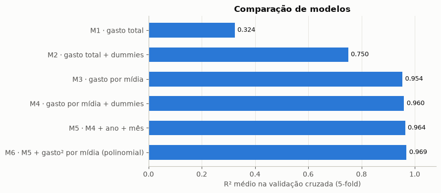
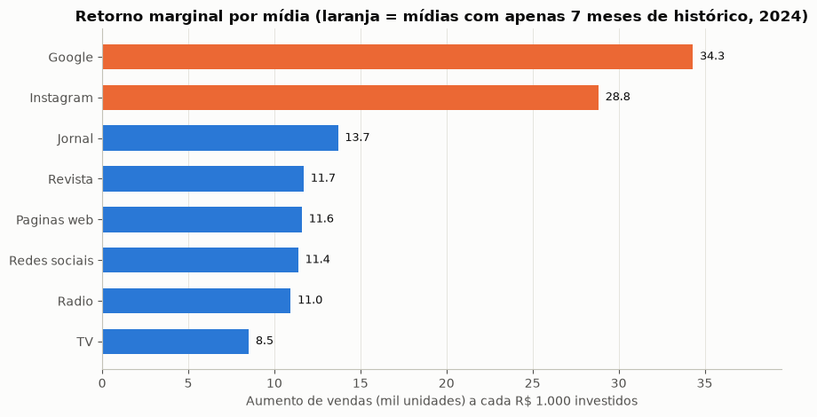
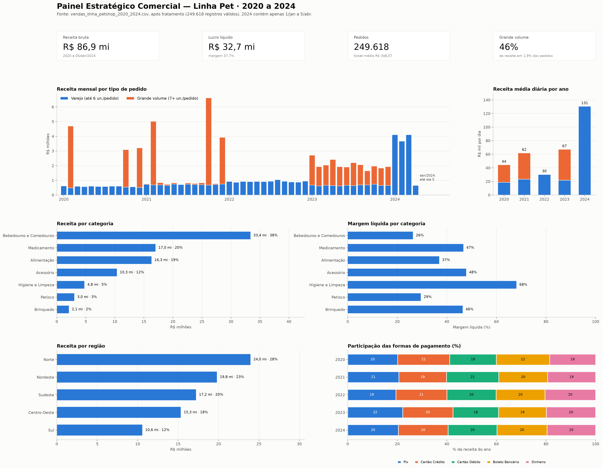

# Melhores Compras: painel de vendas e ROI em publicidade

**Tratamento de 250 mil vendas, painel estratégico para a área comercial e regressão linear para descobrir qual mídia dá mais retorno.**

Projeto do 2º ano do Tecnólogo em Data Science da FIAP (PBL, Fase 5, 2026) para o e-commerce fictício Melhores Compras.

| Desafio | O que foi feito | Destaque |
| --- | --- | --- |
| [1 · Painel de vendas da linha Pet](docs/desafio1-painel-vendas-pet.pdf) | Limpeza de 250.059 vendas (2020–2024) e painel estratégico em Python | **46% da receita** vem de só **1,9% dos pedidos** |
| [2 · Análise de dados](docs/desafio2-analise-dados-pet.pdf) | Divisão treino/validação/teste, tipos de variável, outliers e tratamento | Divisão **temporal** 60/20/20 para evitar vazamento |
| [3 · ROI em publicidade](notebooks/analise_roi_publicidade.ipynb) | Regressão linear do gasto por mídia contra o aumento de vendas | Modelo com **R² de 0,97** fora da amostra |

---

## 3 · Qual mídia dá mais retorno? (regressão linear)

**Dados:** 200 registros mensais (jan/2022 a jul/2024) com o gasto em 8 mídias e a previsão de aumento de vendas.

### Qualidade dos dados

- 3 valores de gasto vieram com vírgula decimal (`99388,8`), o que transformava a coluna inteira em texto. Foram convertidos só em memória.
- **Google e Instagram só existem em 2024** (7 meses). As conclusões sobre esses canais se apoiam em poucos pontos.

### Do modelo simples ao melhor R²

| Modelo | O que entra | R² na validação cruzada (5-fold) |
| --- | --- | --- |
| M1 | só o gasto total | 0,32 |
| M2 | + dummies de mídia | 0,75 |
| M3 | **gasto separado por mídia** | **0,95** |
| M4 | M3 + dummies | 0,96 |
| M5 | M4 + ano e mês | 0,96 |
| M6 | M5 + gasto² por mídia | **0,97** |

<p align="center"></p>

O maior salto vem de **separar o gasto por mídia** (`gasto × dummy`). Com isso, cada canal ganha a própria inclinação, que é exatamente o seu retorno marginal. A escolha foi feita por validação cruzada, comparando treino e teste para detectar overfitting.

### ROI por mídia

<p align="center"></p>

| Mídia | Retorno a cada R$ 1.000 adicionais (mil unidades) | Leitura |
| --- | --- | --- |
| **Google** | 34,3 | melhor ROI (só 7 meses de histórico) |
| **Instagram** | 28,8 | 2º melhor (só 7 meses) |
| Jornal | 13,7 | só compensa com orçamento alto |
| Revista | 11,7 | eficiente com orçamento pequeno |
| Páginas web | 11,6 | melhor canal tradicional, com sinais de saturação |
| Redes sociais | 11,4 | intermediário |
| Rádio | 11,0 | eficiente com orçamento pequeno |
| **TV** | **8,5** | **menor ROI** e **maior verba** (26% do total) |

**Recomendações para o Marketing:**
1. Ampliar Google e Instagram **aos poucos e medindo**: o retorno é cerca de 4× o da TV, mas o histórico ainda é curto.
2. Testar a realocação parcial da verba de TV para o digital, lembrando que a TV pode ter um valor de marca que este modelo não mede.
3. Validar as mudanças com testes controlados, porque regressão mostra associação, não causa. Além disso, a variável é a **previsão** de vendas, não a venda realizada.

## 1 · Painel estratégico da linha Pet

O enunciado permitia Power BI, Tableau ou ferramenta similar. Usamos **Python (pandas + matplotlib)**, para o painel ser reproduzível do CSV bruto até o gráfico.

**Tratamento da base (250.059 linhas):** leitura em Latin-1 com separador `;` e vírgula decimal. Os anos de 2022 e 2024 vieram exportados como texto ("R$ 2.500"), cerca de 40% da base, e o valor unitário foi reconstruído. Também recuperamos quantidades vazias ou com texto e recalculamos totais inconsistentes. Cada regra virou uma *flag* na cópia tratada, então toda decisão pode ser auditada. Ficaram 249.618 registros válidos.

<p align="center"></p>

**Principais achados:**
- **46% da receita vem de 1,9% dos pedidos** (grande volume, 7 unidades ou mais). Por isso, metas e estoque não podem tratar esses pedidos como varejo comum.
- O número de pedidos por dia ficou estável (cerca de 137) de 2020 a 2023. O crescimento veio do valor dos pedidos, não de mais clientes.
- Bebedouros e Comedouros lidera a receita (38%) com a menor margem (26%). Higiene e Limpeza tem a maior margem (68%) e é candidata a venda cruzada.
- O grande volume se concentra em fevereiro, outubro e dezembro, meses que pedem estoque e logística reforçados.

## 2 · Análise de dados para ciência de dados

- **Divisão das bases:** como são vendas no tempo, a divisão é **cronológica**: treino 2020–2022, validação 2023 e teste 2024. Os limites de outliers e as imputações são calculados só no treino, para evitar vazamento.
- **Código do pedido:** serve para rastrear e deduplicar, mas **não deve entrar no modelo**. É sequencial no tempo e criaria uma correlação falsa.
- **Outliers por IQR**, escolhido porque as variáveis são assimétricas. Os registros foram marcados com flags, sem apagar nada, e a winsorização foi descartada para a quantidade, porque achataria o segmento que traz metade da receita.

## Como rodar

```bash
pip install pandas numpy matplotlib seaborn scikit-learn
jupyter notebook notebooks/analise_roi_publicidade.ipynb
```

O notebook lê `data/gastos_publicidade.csv` e não altera o arquivo original. A base de vendas da linha Pet (250 mil linhas) foi fornecida pelo curso e não é publicada aqui. Os resultados estão nos PDFs da pasta `docs/`.

## Habilidades aplicadas

`Python` · `pandas` · `scikit-learn` · `Regressão linear` · `Variáveis dummy` · `Validação cruzada` · `Feature engineering` · `Tratamento de dados sujos` · `Outliers (IQR)` · `Prevenção de vazamento de dados` · `Data visualization` · `Painel executivo` · `Storytelling com dados`

## Equipe (Grupo Paladinos)

- Igor Cardoso Soares da Silva
- Murilo Jucá de Carvalho
- Rozana da Malta Martins
- Ruan Duarte Garcia

> A Melhores Compras é uma empresa fictícia, usada como estudo de caso no curso.
